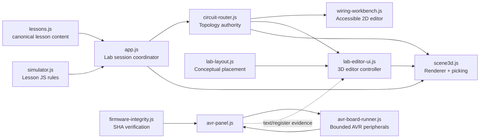

# Kiến trúc sản phẩm Arduino 3D Việt Nam v1.5

Ngày thiết kế: **28/10/2026 (Asia/Bangkok)**
Baseline đã chốt: **`8992c32d270bc9858d9d601dc48b1ae98ec5173b`**.
Tài liệu này mô tả kiến trúc đích cho v1.5 dựa trên `REFERENCE_GAP_MATRIX.md`, code hiện hữu và các candidate module đang được phát triển song song trong shared working tree. Nó không tự biến candidate chưa commit thành release fact.

## 1. Mục tiêu sản phẩm

V1.5 biến phòng thực hành từ “scene 3D + bàn đấu dây 2D” thành **một lab editor 3D có kiểm soát**, trong đó người học có thể bố trí linh kiện và chọn terminal trực tiếp trong scene nhưng mạch điện vẫn được sở hữu bởi engine topology hiện tại. Đồng thời, lesson flow phải nói rõ loại bằng chứng đang được xem: mô phỏng sư phạm JavaScript, netlist learner, hay firmware AVR đã kiểm SHA.

Ba invariant quan trọng hơn visual parity:

1. **Scene không quyết định electrical truth.** `circuit-router.js` vẫn là owner duy nhất cho connect/disconnect/analyze và activation eligibility.
2. **Tọa độ 3D không phải tọa độ vật lý.** Cho đến khi có breadboard-hole connectivity model được kiểm chứng, mọi placement/terminal anchor dùng logical display space và công bố `physicalVerified:false`.
3. **AVR evidence không tự lái scene.** D13/ADC/USART từ verified firmware chỉ là register evidence; muốn bind một output AVR vào animation phải có capability/parity contract riêng cho output đó.

## 2. Hai lớp trạng thái độc lập cần giữ



**Electrical state** gồm `circuit`, `analysis`, `active`. **Visual layout state** gồm component positions/rotation/terminal anchors. Hai state có cùng `lessonId` và canonical component IDs, nhưng không được nhập thành một object làm cho “đặt đúng chỗ” đồng nghĩa “nối đúng điện”. Candidate `src/lab-layout.js:1-6,309-331` đã theo đúng nguyên tắc này: logical-grid, claims `physicalVerified:false`, `breadboardHoleMapping:false`, `electricalPower:false`.

## 3. Authority map

| Concern | Owner v1.5 | API/contract | Không được làm |
| --- | --- | --- | --- |
| Lesson text, components, controls, reference sketch | `src/lessons.js` | `lessons`, `lessonById`, `defaultControls`, `validateLessons` (`src/lessons.js:12+,446-468`) | Không nhét scene geometry/runtime truth vào lesson prose. |
| Circuit connectivity | `src/circuit-router.js` + two engines | `createCircuit`, `connectCircuit`, `disconnectCircuit`, `analyzeCircuit`, `listTerminals`, `createSampleCircuit` (`src/circuit-router.js:62-123`) | Scene/UI không tự thêm “valid wire” ngoài router. |
| Circuit activation | App/controller | Chỉ khi `analysis.ok && analysis.functional`; signal-only 10/14 remain non-activatable | Không kích motor/pump chỉ vì signal reference đã đủ. |
| Conceptual component placement | `src/lab-layout.js` | pure create/move/rotate/anchor/validate | Không lưu voltage/current/power/hole index vào layout. |
| 2D accessible wiring | `src/wiring-workbench.js` | same circuit commands; click/drag + HTML controls (`:174-285`) | Không tạo graph thứ hai cho 2D. |
| 3D rendering/picking | `src/scene3d.js` | `setLesson`, `setWiring`, v1.5 `setLabLayout`, `setLabEdit`; callbacks only | Không quyết định correctness hoặc persistence. |
| Lesson behavior | `src/simulator.js` | pure `simulate(...)` | Không gọi đây là execution của Sketch/C++. |
| Verified firmware load | `src/firmware-integrity.js` | `loadVerifiedFirmware()` | Không chạy HEX chưa qua source/manifest/raw-byte SHA boundary. |
| AVR CPU/peripheral subset | `src/avr-board-runner.js` | capability object + runner API (`:16-33,41-158`) | Không tự nâng `completeArduinoUno`/`physicalHardware` thành true. |
| AVR UI/evidence | `src/avr-panel.js` | `mountAvrPanel(host,{onEvidence})`; evidence origin `verified-avr-register-model` (`:22-27,136-188`) | Không feed register evidence trực tiếp vào LED mesh/netlist. |
| Progress | `src/storage.js` | normalized local progress + export/import | Không buộc account/password cho workflow cơ bản. |

## 4. Lab layout API

Candidate working tree hiện đã có shape phù hợp và nên được giữ pure:

```js
createLabLayout(lessonId, terminals)
moveLabComponent(layout, componentId, x, z)
rotateLabComponent(layout, componentId, quarterTurns)
labTerminalAnchor(layout, terminalId)
validateLabLayout(layout, terminals)
```

Nguồn: `src/lab-layout.js:309-425,432+`. Những rule nên được coi là contract v1.5:

- coordinate unit là `logical-grid`, không phải mm (`lab-layout.js:309-328`);
- Arduino board có thể fixed; breadboard/component khác có thể move/rotate tùy model;
- move phải snap, bounded và giải collision deterministically (`lab-layout.js:353-371`);
- terminal anchor được suy từ canonical terminal → component mapping, không tạo row/column/hole (`lab-layout.js:406-425`);
- validation từ chối claim physical verification giả. Candidate contract đã kiểm trực tiếp invariant này (`tests/lab-layout-contracts.js:56-99,187-224`).

Layout nên tồn tại theo lesson trong session memory trước. Persistence chỉ thêm sau khi schema/version/migration rõ; layout không phải progress và di chuyển component không được tự đánh dấu lesson complete.

## 5. 3D editor API: renderer nhận intent, controller thực thi command

Reference R3 cho thấy raycast terminal trực tiếp tạo cảm giác “cắm dây” tốt (`sources/learn-arduino-button-kr/index.html:1718-1761`), nhưng validator của nó hard-code pair (`:1794-1873`). V1.5 nên giữ interaction đó ở view layer và gửi intent về controller.

API scene mục tiêu:

```js
scene.setLabLayout(layout)
scene.setLabEdit({
  enabled,
  onSelectComponent(componentId),
  onMoveComponent(componentId, logicalX, logicalZ),
  onTerminalSelect(terminalId),
})
scene.setWiring(circuit, terminals, analysis)
```

Candidate `lab-editor-ui.js:156-161,173-210` đã kỳ vọng đúng surface này. Trình tự command bắt buộc:

```text
pointer/keyboard on 3D
  -> terminalId/componentId only
  -> lab-editor-ui validates intent
  -> connectCircuit()/moveLabComponent()
  -> analyzeCircuit()/validateLabLayout()
  -> app stores accepted next state
  -> scene receives new immutable state
```

Không mutate mesh rồi “đồng bộ ngược” vào graph. Nếu command bị từ chối, controller giữ state trước và scene render lại state canonical.

### Gesture contract

R3 phân biệt tap và camera drag bằng distance/time threshold (`index.html:1764-1780`). V1.5 cần cùng ý tưởng nhưng không cần copy hằng số/code. Trạng thái pointer nên phân loại tối thiểu `camera-orbit`, `component-drag`, `terminal-pick`; chỉ một mode sở hữu pointer capture tại một thời điểm. Trên mobile, toggle “edit lab” nên làm rõ mode để tránh vô tình xoay camera khi đang nối dây.

## 6. Accessible equivalent bắt buộc

3D editor là progressive enhancement. Candidate `lab-editor-ui.js:24-33,173-225` đã tạo control HTML cho component, position và terminal; hướng này phù hợp R1, nơi text controls/source inspection vẫn hoạt động khi WebGL không có (`sources/codex-howto/assets/atelier/guided/README.md:5-11`).

Mỗi action canvas phải có tương đương:

| 3D action | HTML/keyboard equivalent |
| --- | --- |
| Chọn component | select/list component có accessible name |
| Move component | x/z fields + nudge buttons; renderer chỉ phản ánh accepted layout |
| Rotate component | nút xoay trái/phải |
| Chọn terminal 1/2 | two terminal selects + Connect button |
| Gỡ dây | connection list + remove/undo action |
| Reset layout | explicit reset placement, giữ circuit nếu user không yêu cầu clear |

Không dùng canvas position làm thông tin duy nhất để hiểu mạch; pin labels, connection list và analysis issues phải ở DOM.

## 7. Một lesson session model, nhiều nguồn evidence

App hiện đã có các state song song cho controls, circuit model, active circuit, code draft, AVR panel (`src/app.js:21-30`). V1.5 nên formalize chúng bằng một read model thay vì để UI tự ghép string.

Đề xuất conceptual envelope:

```js
{
  lessonId,
  source: "lesson-js" | "circuit-analysis" | "verified-avr-register-model",
  claims: {
    physicalHardware: false,
    electricalMeasurement: false,
    compiledMachineCode: boolean,
  },
  revision: { appCommit, firmwareSourceCommit? },
  payload
}
```

Đây là schema kiến trúc, chưa phải yêu cầu thêm một runtime abstraction ngay lập tức. Mục đích là buộc UI trả lời được câu hỏi **“giá trị này đến từ đâu?”**.

Current v1.5 candidate đã có một bước nhỏ theo hướng này: `avr-panel.js:177-188` phát evidence text-only với `origin:"verified-avr-register-model"`; `app.js:719-723` chuyển evidence sang lab editor; `lab-editor-ui.js:60-68` hiển thị D13/TX nhưng nói rõ không suy ra LED/dây vật lý.

## 8. Policy khi nối AVR với scene

Không tạo bridge tổng quát `AVR snapshot -> scene.update()` trong v1.5. `scene.update(snapshot)` hiện nhận lesson-JS snapshot (`src/app.js:335-359`), trong khi `AVR_BOARD_LAB_CAPABILITIES` còn loại trừ PWM waveform, Timer1/2, USART RX, motor/servo physics, delay/millis/micros parity và hardware (`src/avr-board-runner.js:16-33`).

Nếu muốn một binding AVR-visible, mỗi binding phải có manifest riêng:

```text
binding id: d13-digital-level
input evidence: verified AVR GPIO PB5 state
visual claim: logic-state indicator only
requires: GPIO register parity contracts + bundled real-HEX integration
forbids: brightness/current/voltage/hardware claims
```

Chỉ binding đạt contract mới được scene đọc. Ví dụ D13 có thể về sau hiển thị một **logic badge** từ PB5; không tự đổi thành “LED thật sáng” nếu chưa mô hình electrical path.

## 9. Lesson UX v1.5: Understand → Inspect → Try → Check

R1 có 4-stage source-derived model (`sources/codex-howto/assets/atelier/guided/model.mjs:18-49`) và explicit completion (`guided/README.md:7-11`). V1.5 có thể áp dụng cơ chế, không copy text/layout:

| Stage | Dữ liệu Arduino3DVietnam | Evidence phải hiển thị |
| --- | --- | --- |
| **Hiểu** | `goal`, `theory`, `insight`, `caution` | lesson-authored content |
| **Quan sát** | 3D component selection + Pinout + inspector | lesson metadata + layout claim `conceptual` |
| **Thử** | controls / lab editor / circuit draft | source = JS lesson rules hoặc circuit analysis; chưa auto-complete |
| **Kiểm tra** | quiz + circuit issues + optional AVR panel | ghi rõ mỗi result source; explicit completion mới đổi progress |

Không bắt learner chạy AVR để hoàn tất bài cơ bản. AVR là “evidence lab” nâng cao; lesson flow vẫn usable khi WebGL/AVR không khả dụng.

## 10. Inspector, schematic, minimap và flow

R4 cho thấy một shell giàu công cụ với inspector/schematic/minimap/current-flow (`sources/learn-microcontroller/site/index.html:160-203`). V1.5 nên triển khai theo thứ tự:

1. **Inspector:** read-only canonical component/terminal labels, polarity/kind/caution; data từ `listTerminals()` + lesson metadata.
2. **Schematic:** deterministic projection từ validated circuit graph, không có riêng connectivity state.
3. **Minimap:** chỉ camera/layout navigation; không chứa electrical meaning.
4. **Flow overlay:** cuối cùng, chỉ khi origin được gắn rõ và không biến thành current measurement claim.

Ba view đầu có thể dùng ngay cả khi mạch chưa active. Flow overlay phải tắt khi source không đủ tin cậy hoặc topology invalid.

## 11. Data model cho component catalog

`lab-layout.js` hiện suy `visualKind` từ component/terminal IDs. Điều này đủ để prototype nhưng v1.5 lâu dài nên có **component presentation registry** tách khỏi lesson prose:

```js
componentPresentation[idOrKind] = {
  visualKind,
  logicalSize,
  terminalOrder,
  labels,
  assetRef: null | provenanceKey,
  capabilities: { movable, rotatable, inspectable }
}
```

Registry này không chứa electrical equations. `circuit-router` vẫn cung cấp terminal identity/connectivity. Nếu thêm model/texture ngoài, `assetRef` phải trỏ provenance record trước khi build allowlist nhận asset.

## 12. Provenance registry cho reference/asset v1.5

Không cần đưa bốn reference repo vào runtime. Cần một maintenance record đủ trả lời: lấy ý tưởng/asset nào, từ đâu, SHA nào, ngày nào, license status nào.

Đề xuất field cho tài liệu hoặc build-time registry:

```text
id
kind = reference-pattern | source-code | model | texture | icon | font
url
source_commit_or_version
inspected_at
local_evidence_path
license_status = verified | mixed | unknown | reference-only
redistribution_allowed = yes | no | unresolved
notes
```

R1 là ví dụ tốt về tách reference idea khỏi reused asset và giữ notices (`sources/codex-howto/THIRD-PARTY-NOTICES.md:3-23,31-46`). Với R2/R3/R4, status mặc định cho v1.5 phải là `reference-only` cho tới khi audit license cụ thể; không import mesh/code/font từ các repo đó trong phase kiến trúc.

## 13. Integration order

### Gate A — conceptual layout + authority

- Pure layout model có bounds/snap/collision/validation.
- 3D renderer render component placements và terminal anchors.
- 3D terminal pick gọi đúng `connectCircuit` path.
- 2D workbench và 3D editor nhìn cùng circuit object; thay đổi ở một view phản ánh view kia.
- Tests âm chứng minh scene không thể tạo terminal ngoài lesson và layout không thể claim physical mapping.

### Gate B — learner UX

- HTML equivalent cho toàn bộ editor actions.
- Mobile tap/drag/edit-mode behavior.
- Inspector + stage labels Hiểu/Quan sát/Thử/Kiểm tra.
- WebGL fallback vẫn cho học, pinout, wiring HTML, quiz.

### Gate C — evidence views

- Schematic projection từ circuit graph.
- AVR evidence badge/readout qua `onEvidence`, text/register only.
- Nếu thêm scene binding, mỗi binding có capability + positive/negative real-HEX contract.

### Gate D — visual polish/provenance

- Detail/LOD/assets chỉ vào build sau provenance review.
- Measure scene lifecycle, mobile frame budget, context lost/restored, dispose/remount.
- Không thay architecture truth boundary để đạt screenshot parity với reference.

## 14. Acceptance criteria v1.5

V1.5 chỉ nên được gọi là hoàn thành khi các điều sau cùng đúng:

- learner có thể hoàn thành cùng một circuit edit qua 2D HTML và 3D, và hai view dùng cùng `circuit-router` state;
- component placement có thể thay đổi nhưng không thay đổi electrical connectivity trừ khi user thực hiện terminal connection command;
- invalid/signal-only circuit không thể activation chỉ nhờ scene gesture;
- scene metadata tiếp tục công bố conceptual/no physical-hole mapping;
- mọi 3D edit có keyboard/HTML equivalent và mobile mode rõ;
- JS simulation, circuit analysis và AVR evidence có source label khác nhau;
- AVR verified evidence không điều khiển scene output ngoài binding đã có parity contract;
- no-WebGL path vẫn học/quiz/wiring được;
- reference-derived asset/code không vào release nếu provenance/license chưa verified;
- release gate vẫn kiểm cùng final SHA cho build/browser/firmware evidence theo policy hiện tại.

## 15. Quan hệ với candidate code đang chạy song song

Shared working tree quan sát ngày 28/10/2026 đã có các file candidate chưa thuộc baseline `8992c32`: `src/lab-layout.js`, `src/lab-editor-ui.js`, `styles/lab-editor.css`, `tests/lab-layout-contracts.js`; `src/app.js`, `src/scene3d.js`, `index.html` cũng đang được tích hợp bởi worker khác. Kiến trúc trong tài liệu này cố ý **khớp** với hướng candidate hiện tại thay vì phát minh một framework thứ hai:

- `lab-layout.js` là pure conceptual model;
- `lab-editor-ui.js` giữ router làm electrical authority (`:1-13,110-160`);
- app candidate mount editor bằng callbacks circuit thật (`src/app.js:703-723`);
- AVR candidate phát text-only evidence có origin (`src/avr-panel.js:136-188`);
- scene candidate đã bắt đầu có lab edit state/raycaster (`src/scene3d.js:571-592`).

Điểm cần giữ trong review/integration là **không để candidate vượt ranh giới đã nêu**: scene không sở hữu connectivity, layout không phát claim physical, và AVR evidence không tự biến thành animation vật lý. Những candidate này chỉ trở thành capability “Có” sau khi prime tích hợp, kiểm thử và commit theo release gate của dự án.
